# Vulcan UCF user guide

This guide explains how to work with Vulcan UCF day to day: the concepts behind the screens and
the main workflows, step by step. It is written for SOC analysts, detection engineers, purple team
members and the people who report on the SOC.

Installation, configuration, operations and the API are covered in the [README](../README.md).
All screenshots use generated demo data with made-up names.

## Contents

1. [Concepts](#1-concepts)
   - [The use case framework: L1, L2 and L3](#the-use-case-framework-l1-l2-and-l3)
   - [Metrics and scores](#metrics-and-scores)
   - [Lifecycle and definition of done](#lifecycle-and-definition-of-done)
   - [Verification](#verification)
   - [Reference lists](#reference-lists)
   - [Business and compliance drivers](#business-and-compliance-drivers)
   - [Roles](#roles)
2. [Finding your way around](#2-finding-your-way-around)
3. [Use cases and rules](#3-use-cases-and-rules)
   - [Browse and filter the catalogue](#browse-and-filter-the-catalogue)
   - [Create a use case or rule](#create-a-use-case-or-rule)
   - [Maintain a rule](#maintain-a-rule)
   - [Change the status of a use case](#change-the-status-of-a-use-case)
   - [Keep the rule configuration under version control](#keep-the-rule-configuration-under-version-control)
   - [Verify a rule](#verify-a-rule)
   - [Link drivers](#link-drivers)
4. [Priorities](#4-priorities)
5. [Threat modelling with business owners](#5-threat-modelling-with-business-owners)
   - [Add a system](#add-a-system)
   - [Run the interview](#run-the-interview)
   - [Complete, confirm and repeat](#complete-confirm-and-repeat)
   - [Work on detection requests](#work-on-detection-requests)
6. [Purple team tests](#6-purple-team-tests)
   - [Plan a campaign](#plan-a-campaign)
   - [Run tests in rounds](#run-tests-in-rounds)
   - [Close the campaign](#close-the-campaign)
   - [Quick tests](#quick-tests)
   - [Detection gaps](#detection-gaps)
   - [Test library](#test-library)
7. [Output metrics](#7-output-metrics)
8. [ATT&CK coverage](#8-attck-coverage)
9. [History, trends and reports](#9-history-trends-and-reports)
10. [Import, export and git](#10-import-export-and-git)
11. [Administration](#11-administration)
12. [Your account and language](#12-your-account-and-language)
13. [Common questions](#13-common-questions)

---

## 1. Concepts

### The use case framework: L1, L2 and L3

Vulcan UCF implements the FI-ISAC **MaGMa Use Case Framework**. A use case describes something the
SOC wants to detect, on three levels:

| Level | What it is | Example code | Example |
|---|---|---|---|
| **L1** | A broad category, mostly an attack phase or business threat | `AO` | Action on Objectives |
| **L2** | A threat scenario within that category | `AO-ACC` | Account breached |
| **L3** | A detection rule that implements the scenario in the SIEM | `AO-ACC-01` | Detect Unauthorized Usage of Valid Accounts |

The code of a child always starts with the code of its parent, so `AO-ACC-01` belongs to `AO-ACC`,
which belongs to `AO`. L1 and L2 describe the *why* (purpose, threat actors, risk, drivers); L3
rules carry the *how* (metrics, data sources, ATT&CK techniques, SIEM configuration).

On first start the app is filled with the default MaGMa catalogue. You can extend it with your own
L1, L2 and L3 use cases. An L1 can be marked as **not applicable** to your organisation: it is
then left out of every score, together with all its L2 use cases and rules.

### Metrics and scores

Each L3 rule is rated with three values between 0 and 100 %:

| Metric | Question it answers |
|---|---|
| **Effectiveness** | How well does the rule detect the threat if it runs everywhere? |
| **Implementation** | How far is the rule built, tuned and running? |
| **Coverage** | Which share of the in-scope estate sends the logs the rule needs? |

From these the app derives:

- **Weight** = effectiveness × implementation × coverage. This is how much detection the rule
  really delivers today.
- **Potential** = effectiveness − weight. This is how much it could still gain.

Only rules in status *Operational* or *Maintenance* with all three metrics set are scored. The
dashboard combines them into these key figures:

| Figure | Meaning |
|---|---|
| **SOC detection score** | Average weight per L1, averaged over the applicable L1 use cases. Empty L2 use cases are left out and shown as detection gaps |
| **Catalogue coverage** | The same average, but an L2 without scored rules counts as 0. One perfect rule in one of ten L2s gives a 100 % SOC score but 10 % catalogue coverage |
| **Framework completeness** | Share of L2 use cases that have scored rules |
| **Verification health** | Share of operational rules verified in time |
| **Assessment coverage** | Share of active rules that have all three metrics |
| **Growth potential** | Average effectiveness − weight (lower is better) |

Figures are rated *Good* from 70 %, *Fair* from 40 % and *Poor* below (mirrored for figures where
lower is better).

### Lifecycle and definition of done

Every L2 use case and L3 rule has a lifecycle status:

| Status | Meaning |
|---|---|
| **Onboarding** | Being built. New rules start here |
| **Operational** | Live and expected to work |
| **Maintenance** | Live, but being tuned or reworked |
| **Offloading** | Being phased out |
| **Retired** | No longer in use |

Any status can follow any other, with two rules:

- A use case only becomes *Operational* when its **definition of done** is complete: log sources
  deliver data, scope implemented, incident response documented, roles documented, rules
  implemented, tested and documented. An admin can skip the check; that is recorded.
- A *Retired* use case goes back to *Onboarding* first. Going back to onboarding empties the
  checklist, so the way to *Operational* needs a fresh checklist.

Every status change is written to the **change log** with a change driver and a note (see
[Change the status of a use case](#change-the-status-of-a-use-case)).

### Verification

Operational and maintenance rules must be re-tested regularly: by default every 180 days, or the
interval set on the rule. A rule that was never verified, or whose last verification is older than
its interval, is **overdue**. A check that found issues does not count as a verification until a
later check is OK.

A verification is recorded by hand with **Verify now**, or automatically by a successful purple
team test (see [Purple team tests](#6-purple-team-tests)).

### Reference lists

*Setup → Reference lists* holds the pick lists that use cases and rules share:

- **Threat actors**, assigned to L2 use cases
- **Log sources**, **detection technologies** and **scopes** (for example *All users* or
  *Wireless networks*), assigned to L3 rules

Each entry shows which use cases and rules use it. Renaming an entry updates every rule; deleting
an entry that is in use asks first and removes it everywhere. Scopes matter for purple team
tests: a rule counts as verified by tests only when every one of its scopes is covered.

### Business and compliance drivers

Drivers explain *why* the SOC monitors a threat:

- **Business drivers**, such as protecting online payments
- **Compliance drivers**: requirements grouped by a compliance source, for example DORA, NIS2 or an
  internal policy

Drivers are linked to L2 use cases. The L3 rules and the L1 of that L2 inherit them (read-only).
**Driver coverage** is the average weight of the linked L2 use cases, where an L2 without scored
rules counts as 0. A driver without any linked use case is a *gap*; one below 30 % has *low
coverage*.

### Roles

| Role | Can |
|---|---|
| **Admin** | Everything, including users, settings, the STRIDE mapping and deletes |
| **Analyst** | Read and change use cases, rules, drivers, reference lists, systems, interviews and tests (blue team) |
| **Auditor** | Read everything, including the audit log; change nothing |
| **Red team** | Only the purple team campaigns they are assigned to; record how tests were executed. These are local accounts with an end date |

Buttons you are not allowed to use are hidden or disabled, and read-only pages say so.

---

## 2. Finding your way around

The sidebar is grouped by what you do:

| Group | Pages |
|---|---|
| **Daily work** | Dashboard, Use cases (with Detection requests), Verification (with Campaigns, Quick tests, Detection gaps, Test library), Priorities, Threat modelling |
| **Analysis** | ATT&CK coverage, Output metrics, History & trends |
| **Setup** | Business drivers, STRIDE mapping, Reference lists, Import / Export, Integrations |
| **Administration** | Audit log, Users, Settings |

Badges next to an entry count what needs work, for example overdue verifications or open detection
requests.

The **Dashboard** is the starting point. It shows the key figures, a **Needs attention** list
(overdue verifications, open detection requests, gaps in systems, interviews that are due,
detection gaps from tests), detection per L1 use case, upcoming verifications, recent configuration
commits and the coverage per business driver and compliance source.

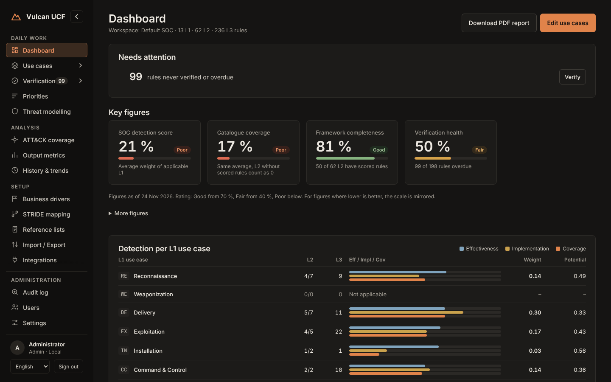

---

## 3. Use cases and rules

### Browse and filter the catalogue

Open **Use cases**. There are two views:

- **Tree**: the L1 and L2 use cases on the left, the selected L2 with its details and rules on the
  right. Search finds use cases, rules and ATT&CK IDs.
- **Table**: all L3 rules in one list with status, metrics, weight, data sources and drivers.
  Filter by status, risk, business driver, compliance source or driver, ATT&CK technique, system
  or a reference entry. Filters are part of the URL, so you can bookmark or share a filtered view.

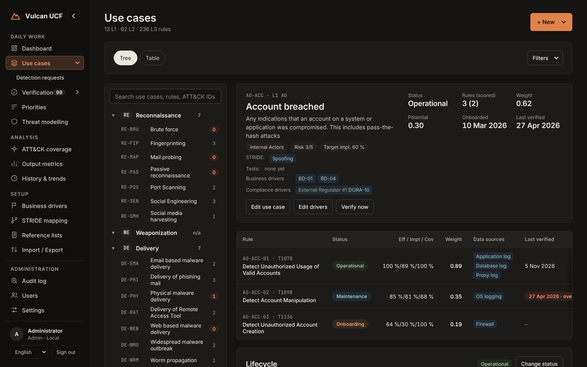

Many values are links to a filtered view. For example, clicking a log source on a rule shows all
rules that use it, and clicking a threat actor shows all L2 use cases with that actor.

### Create a use case or rule

Analysts and admins can add to the catalogue with **+ New** on the *Use cases* page:

1. Choose **L1 use case**, **L2 use case** or **L3 rule**.
2. For an L1, enter a two-letter identifier and a name. For an L2, select its L1 first and enter a
   three-character suffix (for example `LAT` gives `AO-LAT`).
3. For an L3 rule, select the L2 first. The rule ID has the format `<L2>-NN`; extra identifiers may
   go before the number, for example `AO-ACC-WIN-AD-01`.
4. Click **Create**. A new rule starts in *Onboarding*; you set metrics, data sources and status on
   the rule page that opens.

On an empty L2 use case, **+ Add first rule** does the same. To delete an L1 or L2, open **Edit**
on it; this works only when it has no children left. A rule is deleted with **Delete rule** on its
page. Deleting a rule also deletes its
verifications, status changes and configuration history. If systems are linked to it through an
interview, the app lists them and asks first.

### Maintain a rule

Click a rule to open its page.

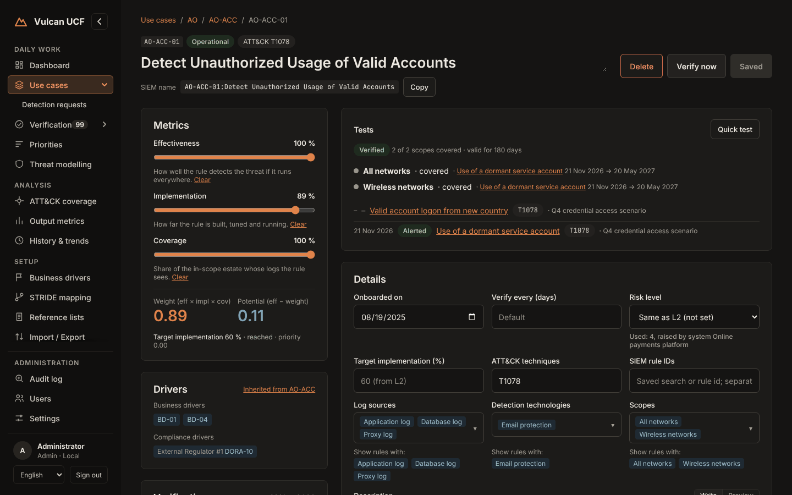

The left column shows the **metrics** (with weight, potential and the target implementation),
the inherited **drivers**, **verification** and **lifecycle**. The right column holds the details
and history:

| Field | Use |
|---|---|
| **Rule name**, **Description**, **Comments** | Free text; description and comments support Markdown |
| **SIEM name** | The name the rule should have in the SIEM, built from the format set by an admin (for example `MYCORP:AO-ACC-01:Detect Unauthorized Usage of Valid Accounts`). Use **Copy** to paste it into the SIEM |
| **ATT&CK techniques** | The techniques the rule detects. Drives the ATT&CK coverage page and test proposals |
| **SIEM rule IDs** | The ID or saved search name in the SIEM, separated by `;`. Links the rule to the SIEM inventory, alert counts and incident imports |
| **Log sources**, **Detection technologies**, **Scopes** | From the reference lists |
| **Risk level**, **Target implementation** | Normally inherited from the L2; set them here to override (see [Priorities](#4-priorities)) |
| **Verify every (days)** | Overrides the default re-verification interval |
| **Onboarded on** | When the rule went live |

Metrics and details are saved with **Save changes**. The definition-of-done checklist, status,
verification, output metrics and configuration are saved as soon as you change them.

The lower part of the page shows the rule's **tests** (scope coverage and open gaps), **output
metrics** per month and the **configuration**.

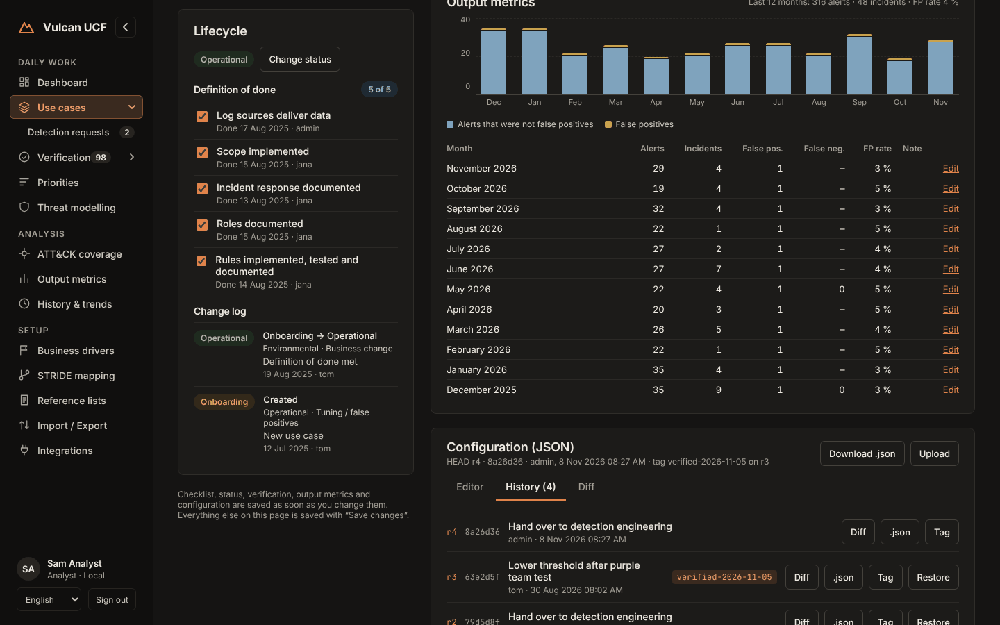

### Change the status of a use case

Status changes always go through a dialog, so the change log stays complete:

1. On the rule page (or the L2 detail), tick the **definition of done** items that are done. Each
   item records who ticked it and when.
2. Click **Change status** in the *Lifecycle* box.
3. Choose the new status in **To**.
4. Choose a **change driver**: *Environmental* (threat landscape, business change, regulation, IT
   infrastructure), *Operational* (red / purple teaming, incident lessons learned, threat hunting,
   tuning / false positives) or *Other*.
5. Add a **note** that says what happened and why, then click **Set to …**.

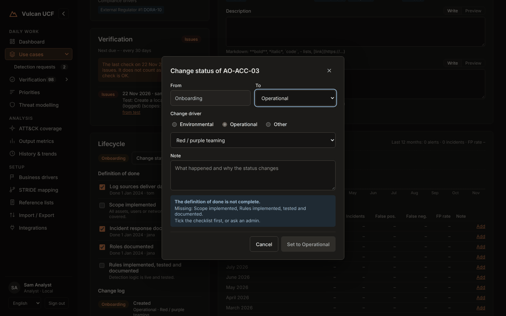

If the definition of done is not complete, the dialog lists what is missing and the change to
*Operational* is blocked. Admins see an extra option to make it operational anyway, which is
recorded as *DoD skipped* in the change log.

The **Change log** below the checklist lists every status change of the use case. *History &
trends* lists the changes of all use cases, filterable by driver.

### Keep the rule configuration under version control

Each L3 rule can keep a **JSON configuration**, for example the query, thresholds and owner. It
works like git without needing git:

1. Open the **Editor** tab of *Configuration (JSON)* on the rule page, or **Upload** a `.json` file.
2. Edit the text. The editor checks that it is valid JSON (an empty text means no configuration).
3. Enter a **commit message** and click **Commit**.

Every commit is immutable and gets a revision number, a short hash, the author and the date.

- **History** lists all commits. From there you can show the **Diff** to the previous version,
  download a version as `.json`, add a **Tag** (for example `prod`) or **Restore** an older
  version. Restore adds a new commit with the old content; nothing is lost.
- **Diff** compares any two versions.
- **Verify now** tags the current version as `verified-<date>`.
- If someone else committed while you were editing, your commit is refused and a diff shows their
  change. Load the latest version, or merge by hand and commit on top.

When a git repository is connected, every commit is also pushed there (see
[Import, export and git](#10-import-export-and-git)). Commits that came from git carry a *from git*
badge.

### Verify a rule

To record that a rule was tested (for example by replaying logs):

1. Click **Verify now** on the rule page, in the table view or on the **Verification** page.
2. Choose the **result**: *Works as expected* or *Issues found*.
3. Add a note and, if the test was not today, the date. Click **Save verification**.

The **Verification** page lists the operational and maintenance rules that are overdue or due
soon (window: overdue only, next 30 or next 90 days), with verification health and the rules whose
last check failed. From there you can also plan a campaign or start a quick test.

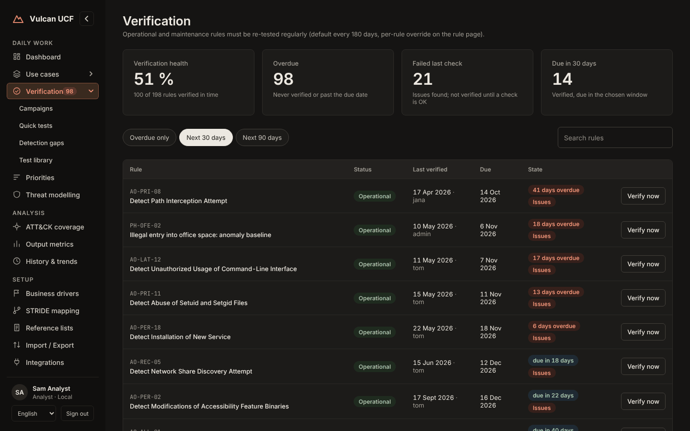

### Link drivers

1. Open an L2 use case in the tree and click **Edit drivers** (or use the drivers column in the
   table view).
2. Tick the business drivers and compliance requirements that apply. Click **Save**.

The L3 rules and the L1 inherit the links. Each change is written to the audit log.

To maintain the drivers themselves, open **Setup → Business drivers**: add business drivers with
**+ Business driver**, compliance sources (for example *ISO 27001*) with **+ Compliance source**,
and their requirements with **+ Requirement**. The page shows the coverage of each driver and
marks gaps. Deleting a driver that is linked asks first and lists the use cases that lose the
link.

---

## 4. Priorities

*Priorities* answers the question "what should we improve next?".

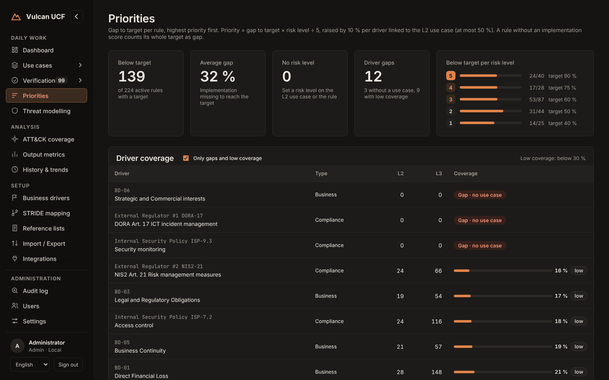

1. Give each L2 use case a **risk level** from 1 to 5 (**Edit use case** on the L2). A rule
   follows its L2 unless you set its own risk level on the rule page.
2. Optionally set a **target implementation**. Without one, the risk level gives the target: by
   default 40 % for risk 1, 50 %, 60 %, 75 % and 90 % for risk 5.
3. Open **Priorities**. Active rules are sorted by

   **priority = gap to target × risk level ÷ 5 × driver boost**

   - The *gap to target* is target − implementation. A rule that meets its target has priority 0.
   - A rule without an implementation score counts its whole target as gap, so unassessed
     high-risk rules show up at the top.
   - Each driver linked to the rule's L2 raises the priority by 10 %, up to 50 %.
   - A completed threat modelling interview can raise the risk level of the rules that cover a
     system's risks (shown as *Risk … from system …*). The higher of the own and the system risk
     level is used.

The summary at the top shows how many rules are below target, the average gap, rules without a
risk level and the driver gaps. Filter by L1, minimum risk level or *only below target*.

---

## 5. Threat modelling with business owners

Threat modelling connects the use case catalogue to the business: for each important application
or platform (**system**) an analyst interviews the business owner, rates the threats with STRIDE
and checks whether the SOC can detect them. What is missing becomes a **detection request**.

### Add a system

1. Open **Threat modelling** and click **+ System**.
2. Enter the name, the business owner (a contact, not a user account), department, e-mail,
   criticality (1–5), data classification, whether it is internet-facing and the **review
   interval** in months (12 by default).
3. Click **Save**.

The list shows each system's detection coverage, gaps, last interview and interview status.
**Interview due or missing** filters the systems that need an interview. A system you no longer
need can be archived: it is hidden, not counted as due and has no effect on priorities.

### Run the interview

On the system page click **Start interview**. The interview has three steps; **Save draft** keeps
your work, and the draft can be continued later.

**1 · Context.** Interview date, participants and notes (Markdown). Attach **evidence** such as
architecture diagrams, PDFs, images or Threat Modeling Tool files (up to 20 MB each) by drag and
drop or **+ Add files**.

**2 · Components and threats.** Split the system into a few **components** (for example web front
end, API, database, admin access). For each component:

1. Choose the **log sources** it sends to the SIEM. Use cases are checked against them.
2. For each STRIDE category (*Spoofing, Tampering, Repudiation, Information disclosure, Denial of
   service, Elevation of privilege*) decide whether the threat **applies**, **does not apply** or
   was **not discussed**.
3. For each threat that applies, describe it and rate **likelihood** and **impact** (1–5). The risk
   score is likelihood × impact (1–25).
4. Optionally add **further threats** linked to MITRE ATT&CK techniques, for example password
   spraying (T1110.003).

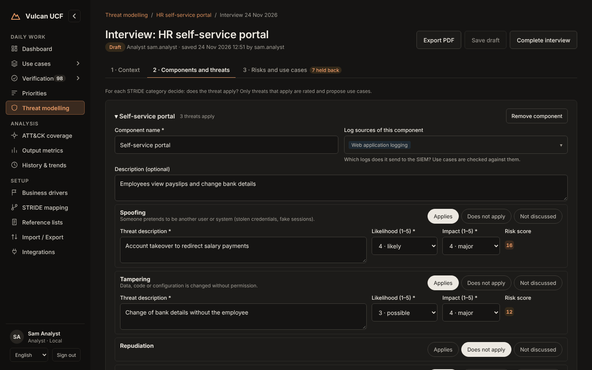

**3 · Risks and use cases.** The app proposes use cases for every threat:

- A STRIDE threat with a risk score at or above the **proposal threshold** (8 by default) proposes
  the L2 use cases mapped to its category in the [STRIDE mapping](#11-administration).
- A custom ATT&CK threat proposes the L2 use cases whose rules cover one of its techniques.
- With the log source filter on, use cases whose active rules need log sources the component
  does not deliver are **held back** and listed separately.

You can add use cases (a whole L2 or a single rule) with **+ Use case**, remove proposals with a
reason, and add **detection requests** for what no use case covers yet.

The **risk / coverage matrix** shows each component × threat as *Covered*, *Partly covered*,
*Gap* or *Below threshold*; click a cell to jump to the risk. Switch between **By risk** and **By
use case**.

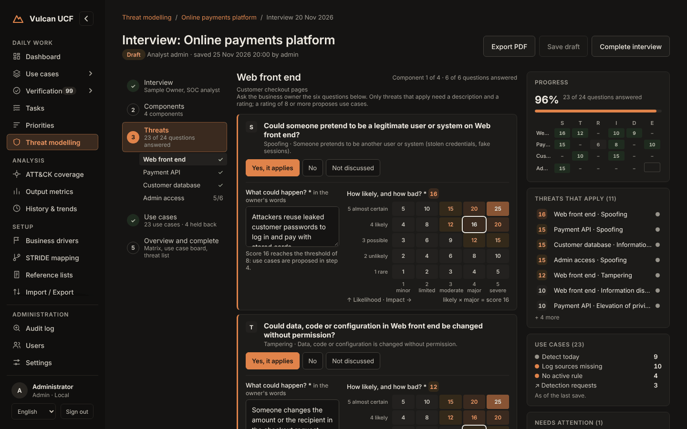

### Complete, confirm and repeat

1. Click **Complete interview**. The app tells you how many use cases will be linked to the system
   (replacing the links of the previous interview), how many of them have no active rule and how
   many detection requests are created. The interview becomes read-only.
2. Click **Export PDF** and send the PDF to the business owner.
3. When the owner agrees, click **Record confirmation**. The interview goes from *Completed* to
   *Confirmed*.

Completing an interview has these effects:

- The system's **detection coverage** is the average weight of the linked use cases.
- The system page lists its **gaps**: risks no use case addresses, linked use cases without
  rules, and use cases whose rules get none (or only some) of their log sources.
- *Use cases* can be filtered by system, and *Priorities* raises the risk level of the linked rules.

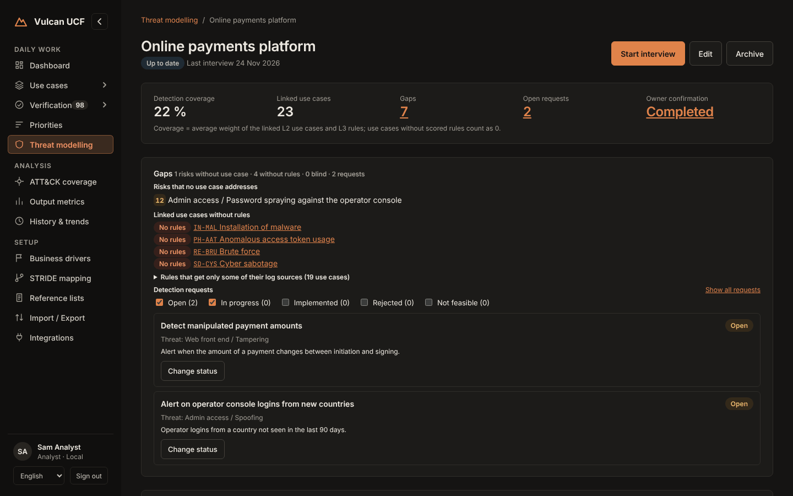

When the review interval has passed, the system is due again. **Start re-interview** creates a
new draft as a copy of the last interview, so you only change what is different.

### Work on detection requests

Detection requests are the to-do list that interviews produce. **Use cases → Detection requests**
lists them for all systems; each system page lists its own.

1. Click **Change status** on a request.
2. Choose *Open*, *In progress*, *Implemented*, *Rejected* or *Not feasible*. Rejected and not
   feasible need a reason.
3. For *Implemented*, optionally enter the code of the use case or rule that implements it.

The status is shared by all interviews of the system, so a re-interview keeps it.

---

## 6. Purple team tests

Tests check whether rules really detect an attack. Each test covers one ATT&CK technique and is
linked to one or more rules and the **scopes** it covered. Find them under **Verification**.

### Plan a campaign

A **campaign** groups the tests of one scenario.

1. Open **Verification → Campaigns** and click **+ New campaign**.
2. Enter name, planned start and end, a description and the **red team accounts** that take part
   (an admin creates them on *Users*). Click **Save**.
3. Add tests:
   - **Add from use cases**: choose L2 use cases; the app proposes one test per ATT&CK technique of
     their rules, uses a library template for that technique if there is one, and asks which
     scopes each test covers.
   - **+ New test**: enter title, technique, description, procedure, tools, expected detection,
     prerequisites and cleanup, or start from a library template. Link the rules and choose the
     covered scopes.
4. Choose the **collaboration** mode:
   - *Hidden*: the red team sees the blue team's results and comments only after the campaign is
     closed (blind test).
   - *Open*: the red team sees them at once.
5. Click **Start campaign**. Results can only be entered while a campaign is running.

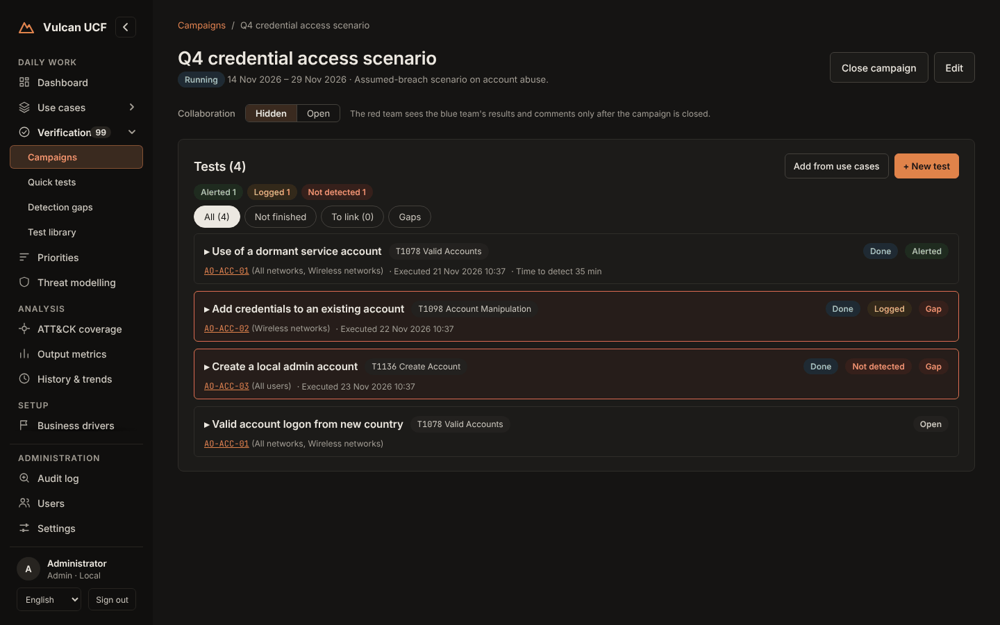

### Run tests in rounds

Every test runs in one or more **rounds**. Each round has two halves:

1. **Red team**: **Record execution**: executed or not executable, start and end time, what was
   executed and notes.
2. **Blue team**: **Record result**:

   | Result | Meaning | Effect |
   |---|---|---|
   | **Blocked** | The attack was prevented | Verifies the covered scopes |
   | **Alerted** | A rule fired | Verifies the covered scopes |
   | **Logged** | The events are in the SIEM, but nothing fired | Detection gap |
   | **Not detected** | Nothing was seen | Detection gap |

   Add the detection time (the app shows the **time to detect**), the detecting rules or
   technologies and notes. Files can be attached to both halves.

If the last result is a gap, fix the rule and click **+ New round** to test again. Comments and
all changes appear in the test's **History**.

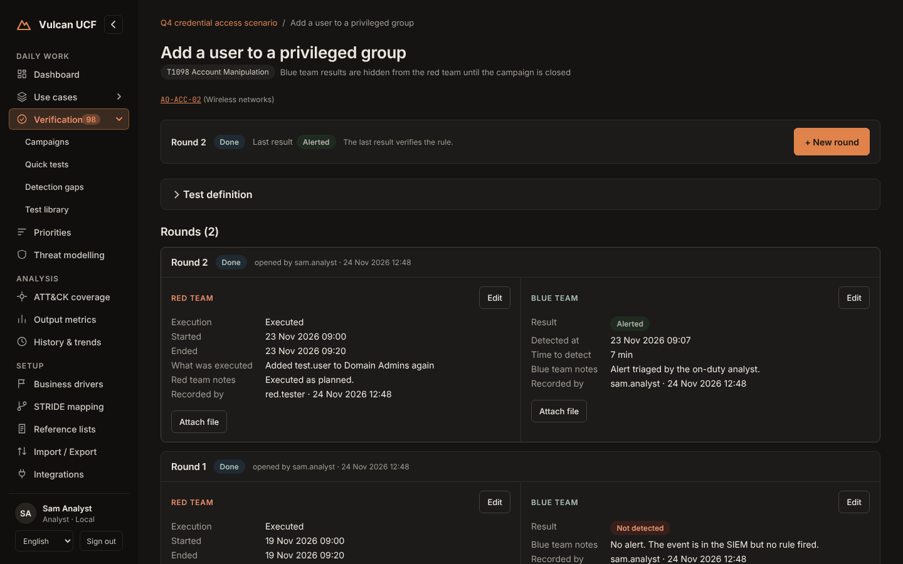

A successful result verifies the covered scopes of each linked rule for the rule's verification
interval. A rule counts as **verified by tests** when every one of its scopes is covered; the
verification then appears on the rule page, marked *from test*. The rule page also shows its test
history and which scopes are covered.

Red team members can add their own tests while the campaign is running. They are marked
*created by the red team* until an analyst links the rules (filter **To link**).

### Close the campaign

Click **Close campaign** when every test's latest round is finished. Tests that still wait for an
execution or a result are listed and block the close. With *Hidden* collaboration, the red team
now sees the blue team's results. **Reopen** brings a campaign back to running.

### Quick tests

For a single test without planning, use **Verification → Quick tests → + New quick test**, or
**Quick test** on a rule page. Execution and result are recorded at once. A quick test without a
linked rule that fails becomes a gap of the technique itself (*No rule covers technique …*).

### Detection gaps

**Verification → Detection gaps** lists every rule (or technique) whose latest test was *Logged*
or *Not detected*. A gap closes when a later test succeeds. If you decide not to fix it, click
**Accept** and give a reason; the gap then no longer counts as open but stays in the history, and
a later test opens the question again.

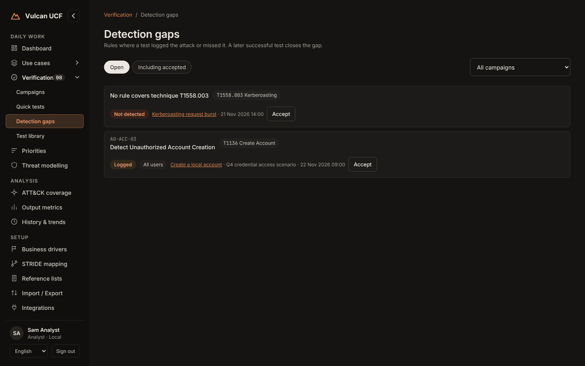

### Test library

**Verification → Test library** holds reusable test scripts (title, technique, procedure, tools,
expected detection, prerequisites and cleanup). Create a template with **+ New template**, or
use **Save to library** on an existing test. A test made from a template is a copy, so changing
the template later does not change existing tests.

---

## 7. Output metrics

Output metrics show what rules produce in practice: per rule and month the **alerts**,
**incidents**, **false positives** and, optionally, **false negatives** (attacks missed and found
later). **Output metrics** shows monthly totals, the false positive rate and the rules with the
most false positives: tuning those first cuts the most noise.

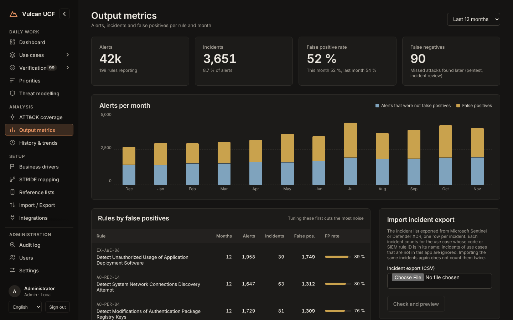

There are four ways to fill them:

1. **By hand**: in the *Output metrics* table of a rule page, click **Add** or **Edit** for a month.
2. **CSV import**: on *Output metrics*, upload a file with the columns `rule, period, alerts,
   incidents, false_positives, false_negatives, note` (period `YYYY-MM`, comma or semicolon
   separated). Click **Check** first: a file with any error imports nothing. Existing months are
   overwritten. **Export CSV** downloads the current numbers in the same format.
3. **Incident export from Microsoft Sentinel or Defender XDR**:
   1. Export the incident list (one row per incident) as CSV.
   2. In **Import incident export**, choose the file and click **Check and preview**.
   3. Review the preview: incidents in the file, matched to a use case, new or changed months
      (before → after) and ignored incidents.
   4. Click **Apply to … months**.

   An incident is matched to a rule by its name: the whole name is the rule's code, one of its
   SIEM rule IDs or its SIEM name; or a part of the name such as `ACME:IA-LNX-01:Password Spray`
   is the code or a SIEM rule ID; or the name starts with the rule's SIEM name. Unmatched
   incidents are listed; add the ID from their name as a **SIEM rule ID** on the right rule to
   count them next time. Per month of *Created on*, alerts are the matched incidents, incidents
   the true positives and false positives the false positives. Importing the same incidents again
   recounts instead of adding twice.
4. **SIEM push**: the SIEM sends counts through the API (see the README, *SIEM integration*).

---

## 8. ATT&CK coverage

**ATT&CK coverage** shows the MITRE ATT&CK Enterprise matrix (bundled with the app, so it works
offline). Each technique is coloured by the best weight of an operational rule mapped to it; a rule
on a sub-technique also counts for its parent. Click a technique to see its rules.

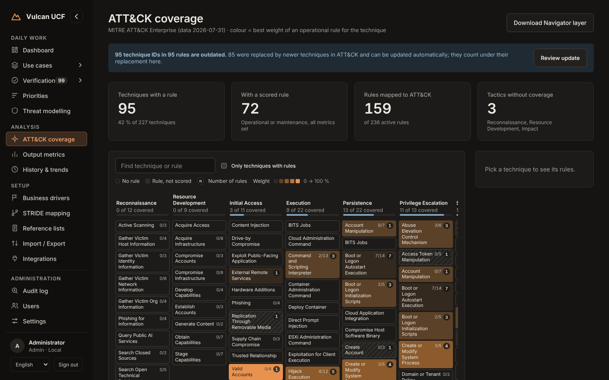

- The summary shows how many techniques have a rule, how many have a scored rule, how many rules
  are mapped and which tactics have no coverage.
- **Download Navigator layer** exports the view for the ATT&CK Navigator (score = weight × 100).
- The MaGMa catalogue uses 2017 technique IDs, many of which were later revoked. The page lists
  outdated IDs; an admin replaces revoked IDs by their successor with **Review update**. Deprecated
  IDs without a successor must be mapped by hand on the rule.

---

## 9. History, trends and reports

**History & trends** shows how the SOC develops over time.

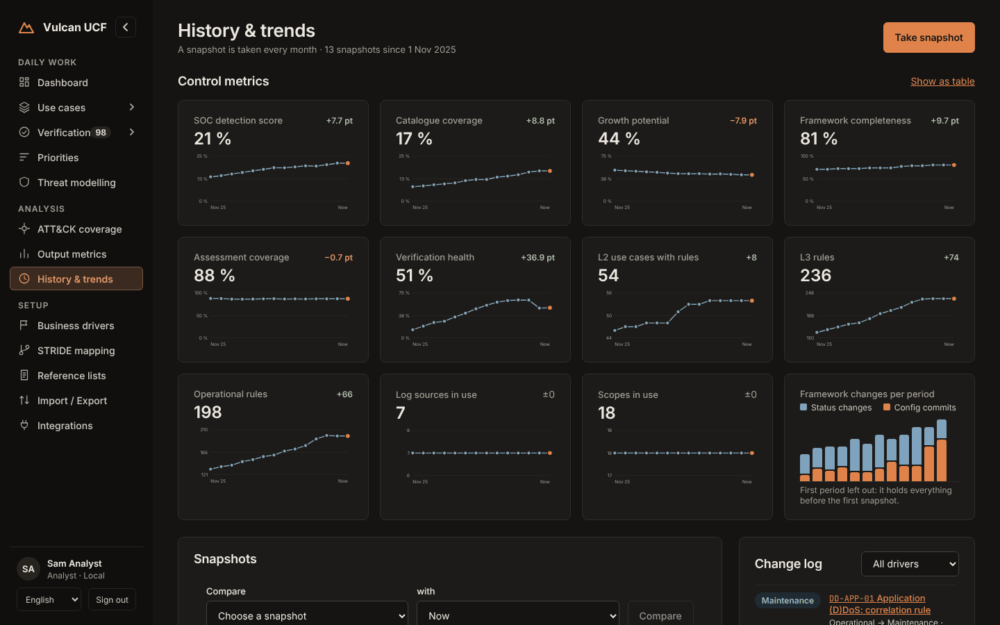

- **Snapshots** freeze all scores, statuses and counts. One is taken automatically every month
  (configurable by the administrator); click **Take snapshot** to add one with a label, for example
  *Before Q4 purple team*.
- **Control metrics** show the trend of each key figure since the first snapshot, as charts or as
  a table.
- **Compare** two snapshots (or a snapshot with now) to see which rules changed, were added or
  removed.
- The **Change log** lists all status changes, filterable by change driver.

**Download PDF report** on the dashboard creates a management report: key figures, the SOC score
trend, detection per L1, top priorities, driver coverage, ATT&CK coverage per tactic, the
noisiest rules and overdue verifications.

---

## 10. Import, export and git

**Setup → Import / Export** exchanges the catalogue with the classic **MaGMa UCF Tool** Excel
workbook:

- **Download Excel (.xlsx)** writes the classic layout (L1 UC, L2 UC, L3 UC, Drivers, References)
  with its formulas, plus extra columns for fields only the app has.
- **Import from Excel** reads the same layout, also from the original tool:
  1. Choose the workbook and the mode: **Merge** adds and updates by ID; **Replace** (admin only)
     also removes everything that is not in the file.
  2. Click **Preview** to see what would be new, changed, unchanged or removed, with notes per row.
     Nothing is saved yet.
  3. Click **Import**.

  The import follows the same rules as the app: the definition of done is checked before a use
  case becomes *Operational*, and every status change goes to the change log.
- **Download JSON export** contains everything, including verifications, the change log, output
  metrics and the configuration history. It is meant for reporting and other tools and cannot be
  imported again; backups are made from the database (see the README).

**Git repository.** When the administrator has connected a git repository, this page shows its
state. Every configuration commit is pushed as a real git commit to
`usecases/<L1>/<L2>/<L3>.json`, and tags become `<code>/<tag>`. With two-way sync, changes that
people push to those files are read back into the app as new commits (*from git*). Changes that
could not be taken over (conflict, invalid JSON, unknown path) are listed here. Admins can
**Sync now**.

---

## 11. Administration

These pages are for admins (the audit log also for auditors).

| Page | What you do there |
|---|---|
| **Users** | Add local users with a role (**Add local user**), change roles, disable or delete accounts, reset passwords and two-factor login. Red team accounts have an end date: fixed, or following the end of their campaigns. SSO accounts get their role from the identity provider |
| **Audit log** | Every sign-in and change with old and new values, imports, settings changes and the client address |
| **Settings** | The **SIEM name** format of rules, such as `$companyName:$ucID:$ucName`, with your own variables (`companyName = MYCORP`). Built-in variables: `$ucID`, `$ucName`, `$l2ID`, `$l1ID`. Also shows the space used by interview evidence |
| **STRIDE mapping** | Which L2 use cases each STRIDE category proposes in interviews, the **proposal threshold** (1–25) and the **log source filter**. Lists L2 use cases no category proposes. **Restore default mapping** resets it |
| **Reference lists** | Threat actors, log sources, detection technologies and scopes (analysts too) |
| **Business drivers** | Business drivers, compliance sources and requirements (analysts too) |
| **Integrations** | **API tokens** for the SIEM (*SIEM push only*, *Read only* or both), the SIEM rule inventory, SIEM rules without a use case (with suggestions by ATT&CK technique) and rules disabled in the SIEM but operational in the app |
| **Import / Export** | Replace imports, git sync and, where enabled, loading demo data |

**Single sign-on.** When OIDC is set up, the sign-in page shows a button for the identity
provider. Users are created on their first sign-in, and their role follows their IdP group at
every sign-in. Setup is described in the README.

---

## 12. Your account and language

Click your name at the bottom of the sidebar to open **Account**.

- **Change password** (local accounts). Changing it signs you out everywhere else.
- **Two-factor login** (local accounts):
  1. Click **Set up** and confirm with your password.
  2. Scan the QR code with an authenticator app (or type the key) and enter the 6-digit code.
  3. Save the eight **recovery codes**. Each signs you in once if you lose your phone; they are not
     shown again. **New recovery codes** replaces them.

  From now on the sign-in page asks for the code after the password. If you lose both phone and
  recovery codes, an admin can reset the second factor on *Users*.
- SSO accounts manage password and second factor at the identity provider.

**Language.** Choose English, German (Deutsch) or Dutch (Nederlands) at the bottom of the sidebar
or on the sign-in page. The choice is saved on your account and follows you to other browsers.
Without a choice the browser language is used. The data itself (use case names, descriptions, the
ATT&CK catalogue) stays as entered.

---

## 13. Common questions

**Why does my rule not count towards the SOC score?**
Only rules in *Operational* or *Maintenance* with effectiveness, implementation and coverage set
are scored, and only under an applicable L1. The rule page says what is missing.

**Why can I not set a use case to Operational?**
The definition of done is not complete. Tick the missing items on the rule or L2 page, or ask an
admin to skip the check.

**Why is a rule overdue although we tested it in a campaign?**
A test verifies a rule only when every scope of the rule is covered by a successful result
(*Blocked* or *Alerted*) within the verification interval. The *Tests* box on the rule page shows
which scopes are still open.

**Why were incidents ignored by the incident import?**
Their name does not contain the rule's code, a SIEM rule ID or the SIEM name. Add the ID used in
the incident name as a **SIEM rule ID** on the rule and import the file again.

**Can I undo a configuration change?**
Yes. In *Configuration → History* click **Restore** on the old version. This adds a new commit
with the old content.

**Where is the history of a status change?**
In the *Change log* of the use case and, for all use cases, on *History & trends*. Every other
change is in the audit log.
